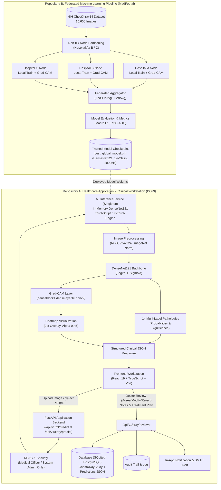

# DORI + MedFed AI Integrated System Architecture

## 1. Executive Summary & Purpose

This system unites two independently developed, state-of-the-art healthcare engineering systems into one cohesive, clinically deployable application:

* **Repository A (`dori-main`)**: **DORI** (Predictive Continuity of Care Infrastructure for Rural India) — handles clinical encounters, decentralized patient Care Passports, closed-loop referrals, care-gap tracking, and attending physician workstations.
* **Repository B (`MedFed.ai-main`)**: **MedFed.ai** (Privacy-Preserving Federated Diagnostics Engine) — handles distributed multi-node federated training, Fed-FibAvg aggregation, Opacus differential privacy, Prime-DP additive masking, evaluation, and checkpoint preparation on the NIH Chest X-ray dataset.

The healthcare application (Repository A) consumes the trained medical-image classification model (`MedFedDenseNet121`) produced by Repository B through a backend service interface (`MLInferenceService` and `/api/v1/ml/predict`).

---

## 2. Logical Integrated Architecture



---

## 3. Strict Separation of Concerns

| Capability | Repository A (DORI) | Repository B (MedFed.ai) |
| :--- | :--- | :--- |
| **Primary Domain** | Healthcare Workflows & Care Continuity | Federated Learning & Model Development |
| **Dataset Storage** | No raw training sets; patient records only | Partitioned local hospital splits (A, B, C) |
| **Model Training** | None (read-only inference) | Federated orchestration (Flower, Fed-FibAvg, Opacus) |
| **Model Checkpoint** | Consumes versioned artifact from registry | Produces, aggregates, and evaluates weights |
| **Inference Trigger** | On-demand per clinician examination | Never triggered by routine inference |
| **Clinician Interface** | Radiologist Workstation, Referral Tracker | Research & Evaluation dashboards |
| **Privacy Layer** | ABAC/RBAC, ABHA credentials, audit trails | Prime-DP masking, differential privacy ε=0.5 |

---

## 4. Model Checkpoint & Specifications

* **Architecture**: `MedFedDenseNet` (DenseNet121 with customized multi-label classification head)
  * Feature Extractor: DenseNet121 backbone (`num_features = 1024`)
  * Classifier Head: `nn.Sequential(nn.Dropout(p=0.2), nn.Linear(1024, 14))`
  * Output: 14 raw logits converted to calibrated probabilities via `torch.sigmoid(logits)`.
* **Pathology Classes (14 NIH Chest X-ray Standards)**:
  1. `Atelectasis` (Index 0)
  2. `Cardiomegaly` (Index 1)
  3. `Consolidation` (Index 2)
  4. `Edema` (Index 3)
  5. `Effusion` (Index 4)
  6. `Emphysema` (Index 5)
  7. `Fibrosis` (Index 6)
  8. `Hernia` (Index 7)
  9. `Infiltration` (Index 8)
  10. `Mass` (Index 9)
  11. `Nodule` (Index 10)
  12. `Pleural_Thickening` (Index 11)
  13. `Pneumonia` (Index 12)
  14. `Pneumothorax` (Index 13)
* **Checkpoint File**: `best_global_model.pth` (28,485,747 bytes)
  * Format: PyTorch checkpoint dictionary containing `round`, `strategy` (`fed-fibavg`), `privacy` (`none`), `global_macro_f1`, `global_roc_auc`, and `model_state_dict` (727 tensor keys).
* **Preprocessing Pipeline**:
  * Input Format: RGB (converted from PNG/JPEG/WEBP/BMP/TIFF)
  * Min Dimensions: 64x64, Max Dimensions: 4096x4096, Target: 224x224
  * Mean: `[0.485, 0.456, 0.406]`, Std: `[0.229, 0.224, 0.225]`
* **Explainability (Grad-CAM)**:
  * Target Layer: `densenet.features.denseblock4.denselayer16.conv2`
  * Global average pooling of gradients applied to feature activation maps with ReLU filtering and colormap blending (alpha 0.45, jet colormap).

---

## 5. REST API Interfaces

### 5.1 General Machine Learning Inference
`POST /api/v1/ml/predict`

**Authorization**: Bearer JWT (`MEDICAL_OFFICER`, `REFERRAL_FACILITY`, `SYSTEM_ADMIN`)

**Request (Multipart or JSON)**:
```json
{
  "image_base64": "data:image/png;base64,iVBORw0KG...",
  "target_class": "Infiltration",
  "patient_id": "5c21c99a-8e4f-4df9-9d58-5d91b7db3c64",
  "generate_gradcam": true
}
```

**Response (200 OK)**:
```json
{
  "request_id": "6f9ee98d-9232-4264-8540-c64008b156c0",
  "model_name": "MedFed DenseNet121-CheXNet-14Class",
  "model_version": "v1.3 (Fed-FibAvg Global)",
  "device": "cpu",
  "prediction": {
    "labels": ["Pneumothorax", "Consolidation", "Cardiomegaly", ...],
    "scores": [0.5415, 0.5120, 0.4830, ...]
  },
  "findings": [
    {
      "finding": "Pneumothorax",
      "confidence": 0.5415,
      "percentage": 54.15,
      "is_positive": true
    },
    ...
  ],
  "top_finding": "Pneumothorax",
  "top_confidence": 0.5415,
  "explainability": {
    "method": "Grad-CAM",
    "available": true,
    "target_layer": "features.denseblock4.denselayer16.conv2",
    "explained_class": "Pneumothorax",
    "visualization": "data:image/png;base64,iVBORw0KG..."
  },
  "status": "completed",
  "requires_clinician_review": true,
  "safety_disclaimer": "AI-ASSISTED CLINICAL DECISION SUPPORT. NOT A STANDALONE DIAGNOSIS. Final clinical interpretation and decision remain with the qualified clinician.",
  "patient_id": "5c21c99a-8e4f-4df9-9d58-5d91b7db3c64"
}
```

### 5.2 Model Metadata & Status
`GET /api/v1/ml/status`

Returns in-memory model availability, checkpoint round, strategy, device, and class count.

### 5.3 Clinical Workstation Review
`POST /api/v1/xray/reviews`

Persists doctor decision (`agree` | `modify` | `reject`), clinical notes, treatment plan, follow-up schedule, full 14-class prediction payload, and dispatches follow-up alerts.

---

## 6. Environment Configuration

### Repository A (`backend/.env`)
```bash
ENVIRONMENT=development
DATABASE_URL=sqlite:///./dori.db
SECRET_KEY=dev-secret-key-change-in-production
JWT_SECRET=dev-jwt-secret-change-in-production
JWT_ALGORITHM=HS256
ACCESS_TOKEN_EXPIRE_MINUTES=1440

# ML Inference Configuration
MODEL_PROVIDER=medfed
MEDFED_MODEL_PATH=C:/Users/srinu/Music/master fed/MedFed.ai-main/MedFed.ai-main/models/global/current/model.pth
MEDFED_REPO_PATH=C:/Users/srinu/Music/master fed/MedFed.ai-main/MedFed.ai-main
MEDFED_DEVICE=auto
MEDFED_MODEL_NAME=MedFed DenseNet121-CheXNet-14Class
MEDFED_MODEL_VERSION=v1.3 (Fed-FibAvg Global)
MEDFED_MAX_UPLOAD_BYTES=20971520
MEDFED_DATASET_PATH=C:/Users/srinu/Music/fedlearning/DataSET
```

---

## 7. Execution & Startup Instructions

### 1. Start the Backend API (FastAPI + PyTorch)
```powershell
cd "C:\Users\srinu\Music\master fed\dori-main\dori-main\backend"
.\.venv\Scripts\uvicorn.exe app.main:app --host 0.0.0.0 --port 8000 --reload
```
* API runs at: `http://localhost:8000`
* Interactive OpenAPI Docs: `http://localhost:8000/docs`

### 2. Start the Frontend Application (Vite + React 19)
```powershell
cd "C:\Users\srinu\Music\master fed\dori-main\dori-main\frontend"
npx vite --host 0.0.0.0 --port 5173
```
* Application runs at: `http://localhost:5173`

### 3. Log In to the Workstation
* **URL**: `http://localhost:5173`
* **Role**: Medical Officer (or System Admin)
* **Username**: `demo_mo` (or `demo_admin`)
* **Password**: `dori2024demo`
* **Navigate to**: `Medical Officer Dashboard` -> `Chest X-Ray Workstation`

---

## 8. Automated Testing & Verification

Run the comprehensive integration test suite:
```powershell
cd "C:\Users\srinu\Music\master fed\dori-main\dori-main\backend"
uv run pytest tests/test_ml_inference_integration.py -v
```

Run the end-to-end healthcare pipeline test suite:
```powershell
cd "C:\Users\srinu\Music\master fed\dori-main\dori-main\backend"
uv run python test_dori_medfed_unified.py
```

Run TypeScript compilation check:
```powershell
cd "C:\Users\srinu\Music\master fed\dori-main\dori-main\frontend"
npm run build
```
